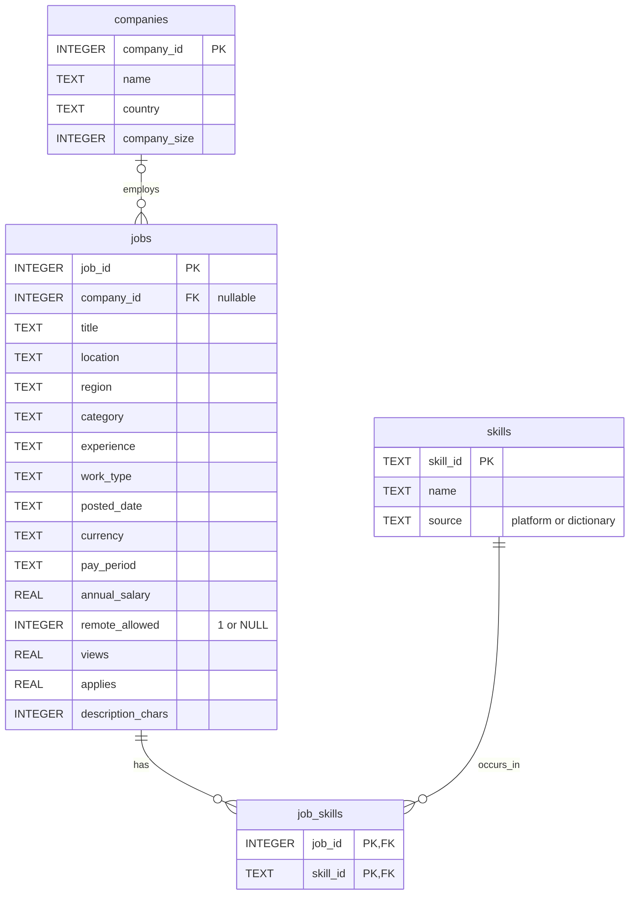

# Схема SQLite

`company_id` может быть NULL, поэтому у вакансии ноль или одна известная компания. Ключ `job_skills(job_id,skill_id)` составной. Справочник `skills` объединяет источники через уникальные префиксы ID. Повтор одного навыка на вакансию не создаёт повторных записей. Внешние ключи проверяются после ETL. Точная DDL находится в sql/schema.sql, графическая версия — outputs/figures/er_diagram.svg.
